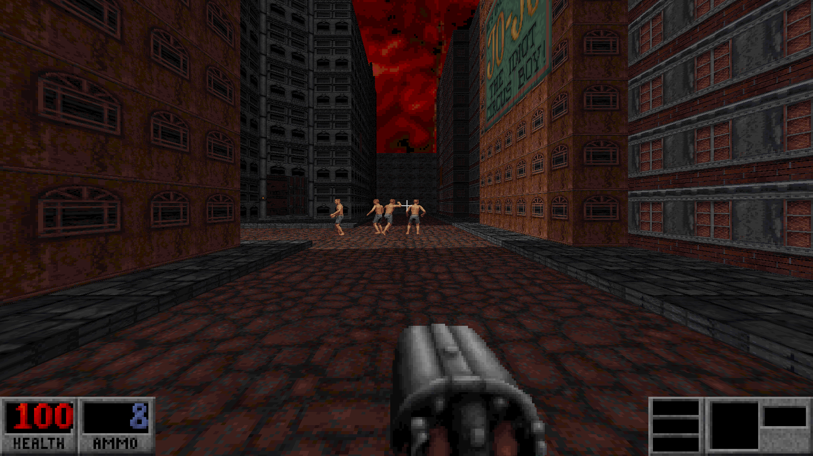
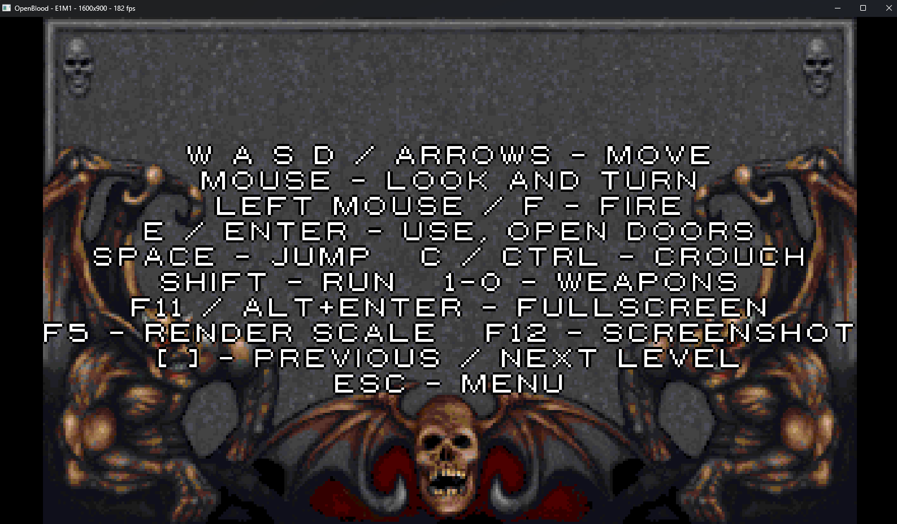
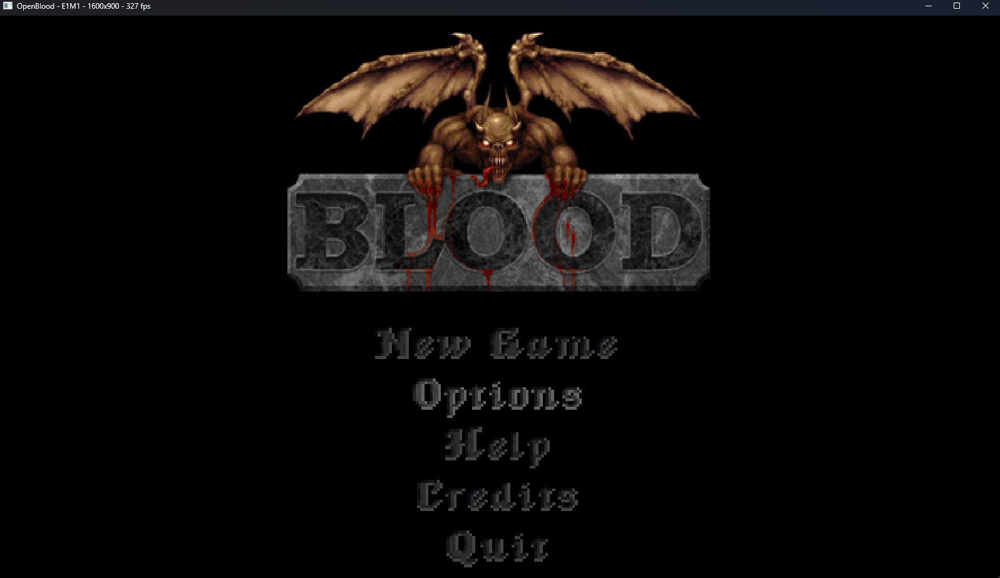
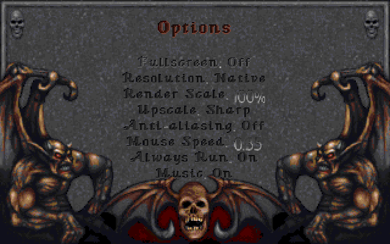
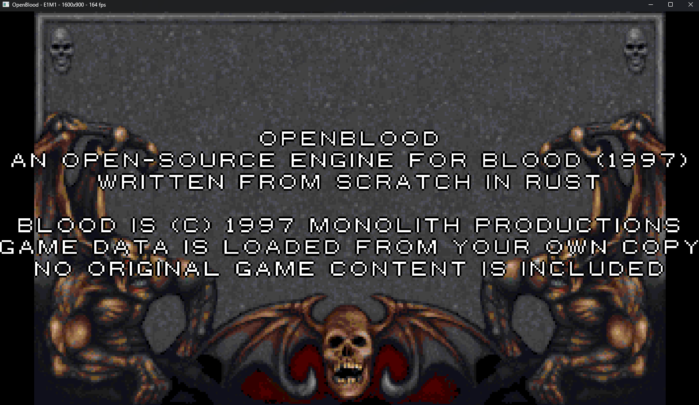
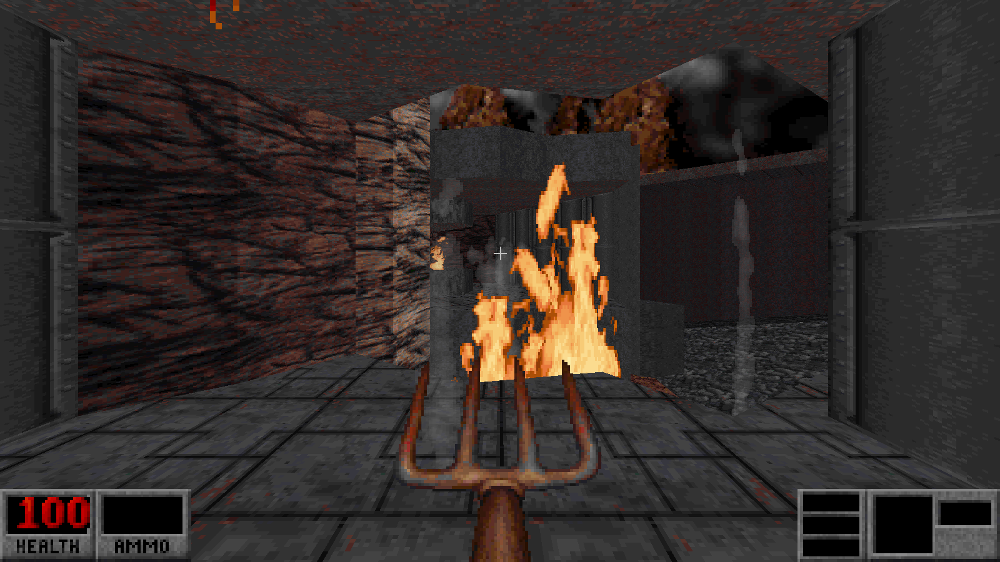
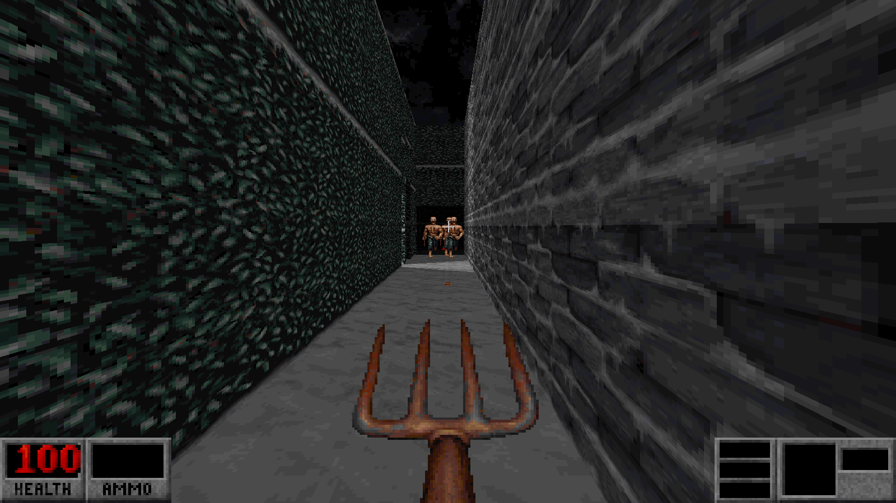
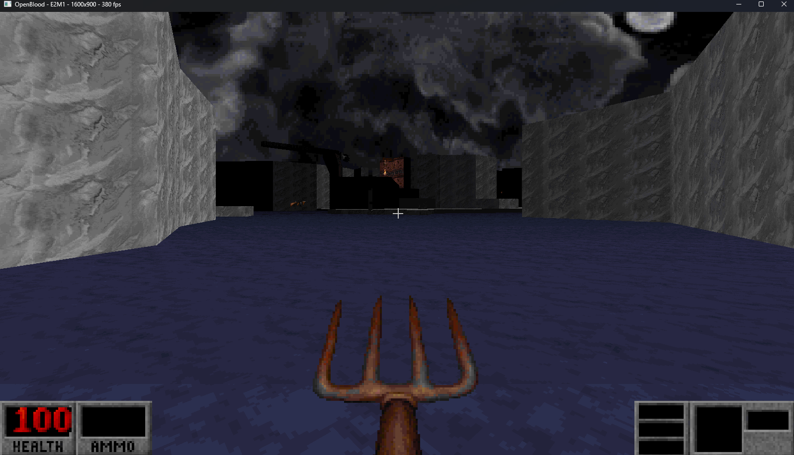
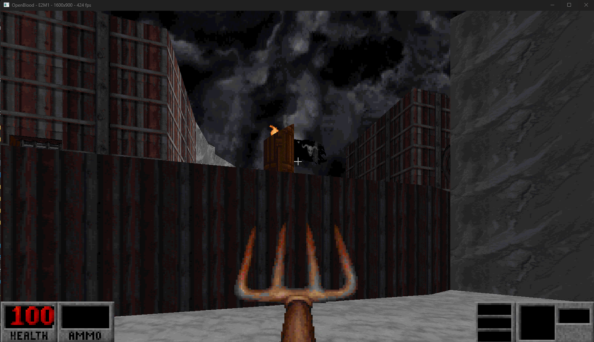
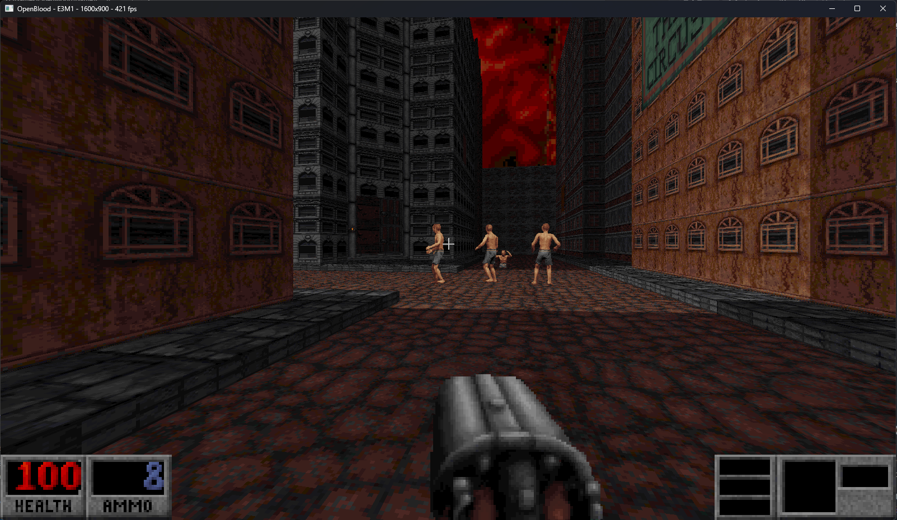

# OpenBlood

[](https://github.com/dagrigorev/OpenBlood/actions/workflows/ci.yml)
[](https://github.com/dagrigorev/OpenBlood/actions/workflows/release.yml)
[](https://github.com/dagrigorev/OpenBlood/releases/latest)
[](https://github.com/dagrigorev/OpenBlood/wiki)
[](https://dagrigorev.github.io/OpenBlood/)

**[Download](https://github.com/dagrigorev/OpenBlood/releases/latest)** ·
**[Wiki](https://github.com/dagrigorev/OpenBlood/wiki)** ·
**[Installation](https://github.com/dagrigorev/OpenBlood/wiki/Installation)** ·
**[Architecture](https://github.com/dagrigorev/OpenBlood/wiki/Architecture)** ·
**[API docs](https://dagrigorev.github.io/OpenBlood/)**



An open-source engine, written from scratch in Rust, that plays **Blood (1997)** on modern
Windows PCs at any resolution — including 4K — using the data files from **your own copy**
of the game.

OpenBlood contains **no** Blood game content (maps, art, sounds, music, executables).
Without the original files it does nothing. Blood is © 1997 Monolith Productions.

## What works

**Data and rendering**

- Clean-room readers for every original data format: `RFF` archives (incl. v3.01
  dictionary/file obfuscation), `ART` tiles, 8-bit palettes and shade/translucency tables,
  encrypted v7 `MAP` files with Blood's X-sector/X-wall/X-sprite bitfields, `SEQ` sprite
  animations, `QAV` weapon animations, `SFX`/`RAW` sounds, `BLOOD.INI`.
- Resolution-independent multithreaded software renderer (per-column portal ray casting,
  sloped floors/ceilings, parallax skies, masked/translucent walls, face/wall/floor sprites,
  8-direction sprite rotation, distance shading from the original palookups).
- Smooth motion at any frame rate: the game runs at a fixed 120 Hz and every frame blends
  the camera and all sprites between the last two ticks, so 60, 144 Hz or uncapped frame
  rates all move evenly.
- Video options: output resolution (native by default), render scale, upscale filter
  (Nearest / Smooth / Sharp), supersampling anti-aliasing (2x / 4x) and a frame-rate cap.
- Level starts don't stall: all sound effects are preloaded once (~26 MB, ~10 ms), CD music
  is streamed from disk in small chunks instead of loading whole tracks, and the HUD is drawn
  at window resolution after scaling. Anti-aliasing 4x at native 4K costs about four times
  the rendering; lower it (or Render Scale) if the frame rate is too low.
- Voxel models (KVX) for items and decorations, ray-cast per pixel, including spinning pickups.
- Room-over-room links: see-through stacked floors/ceilings (per-pixel portal tracing) and
  moving between linked rooms, including diving into water (with the original water palette),
  with sprites in the linked room visible through the portal.

**World and player**

- Player movement and collision (sliding, steps, crouching, fall damage). Walking speed and
  acceleration, jump height (0.8 s in the air) and gravity are measured from the original.
- Blood's trigger/channel system: doors, lifts, sliding/rotating sectors, switches, wait
  timers, locks and keys, level-start broadcasts, teleporters, secrets, exits, messages.
  Level start fires on the player's first move, like the original.
- Sliding/rotating sectors carry sprites and the player (boats, trains, moving platforms).
- Sector lighting effects, ambient/sector/one-shot sounds with 3D panning, CD-audio music
  ripped from your own disc image. Without ripped tracks, the level's MIDI song plays through a
  clean-room FM (OPL-style) synthesizer with Blood's own AdLib instrument bank.

**Combat and enemies**

- Weapons with the original QAV animations and sounds (pitchfork, flare pistol, sawed-off,
  tommy gun, napalm, dynamite, spray can, tesla, life leech, voodoo), hitscan and projectiles,
  explosions, pickups, the original status bar art and menu fonts, episode/difficulty menus,
  INI-driven level progression.
- Alternate fire for every weapon (double-barrel, tommy spread, flare starburst, big napalm,
  dynamite drop, spray-can bomb, tesla charge, voodoo curse), sawed-off reload, guns akimbo.
  Shotgun pellets hitting the same target add up, so a point-blank blast gibs.
- Inventory (doctor's bag, diving suit, jumping boots, beast vision, crystal ball) and timed
  power-ups (invisibility, invulnerability, akimbo, reflective shots, feather fall, rage),
  breathing and drowning underwater.
- Enemy AI with original SEQ animations and voices: ambush / guard / deaf editor flags,
  hearing gunfire, ranged enemies strafe instead of walking into fire, obstacle and ledge
  avoidance, enemies don't walk through each other, fleeing innocents, burning enemies,
  buried zombies rising, stone gargoyles waking when hit or triggered. Enemies stand on their
  feet in every animation frame; unalerted enemies far from the player wander around their
  post instead of standing frozen.
- Tuned against recorded DOSBox fights: axe-zombie speed, damage and swing rate, damage
  scaling by difficulty, shotgun-cultist blast, tommy-gun fire rate.

**Cutscenes**

- Clean-room Smacker (`.SMK`) video decoder. The Monolith and GT Interactive intro plays at
  startup, and the episode cutscenes play where BLOOD.INI places them (CutSceneA on entering
  its level, CutSceneB when an episode ends), with their WAV soundtracks. Any key skips.

**Saving**

- Quick save and five slots, deterministic restore of the whole game state.
  (Saves from older OpenBlood versions can't be loaded after a save-format change.)

Not yet: multiplayer, the full set of enemy behaviours, health/damage
measurements for most enemies.

Known differences: the E1M1 starting coffin still looks different above the coffin walls
(a room-over-room view); eye height and vertical proportions elsewhere were fitted to
screenshots of the original and now match closely.

## Setup

1. Install Blood from your original disc (e.g. in DOSBox) and patch it (1.20/1.21 recommended).
2. Copy these files from the Blood directory next to `openblood.exe` (or set `data_dir` in
   `openblood.ini`): `BLOOD.RFF`, `SOUNDS.RFF`, `GUI.RFF`, `TILES000.ART`…`TILES017.ART`,
   `SURFACE.DAT`, `VOXEL.DAT`, `TABLES.DAT`, `BLOOD.INI`.
3. Optional CD music and cutscenes (without them the FM/MIDI music plays): rip the CD audio tracks and copy the cutscene videos from
   your disc image: `openblood extract-cd BLOODCD1.cue music` (music to `music/`, cutscenes
   to `movie/`; `openblood extract-movies BLOODCD1.cue movie` copies only the videos).
4. Run `openblood.exe` (fullscreen at native resolution by default).

Command line: `--windowed`, `--map E1M1`, `--data <dir>`, `--scale 0.5`, `--maxfps 60`, `--nosound`.

**Tip for E1M1:** you start lying in a coffin. Move once (the coffin floor rises), then jump
(Space) while walking forward to climb over its edge into the crypt.

## Controls

| Action | Keys |
| --- | --- |
| Move | W A S D / arrows |
| Look | mouse (mouse up = look up), PgUp / PgDn |
| Fire / alternate fire | left mouse or F / right mouse |
| Use, open doors | E |
| Jump / crouch / run | Space / C or Ctrl / Shift |
| Weapons | 1 – 0 |
| Inventory: previous / next / use | `[` / `]` / Enter |
| Quick save / quick load | F6 / F9 |
| Menu | Esc |
| Fullscreen | F11 or Alt+Enter |
| Toggle render scale (100% / 50%) | F5 |
| Screenshot / stats | F12 / F2 |
| Previous / next level | Ctrl+`[` / Ctrl+`]` |
| Test cheat (all weapons, ammo, keys) | F10 |



## Options and `openblood.ini`

Everything changed in the Options menu is saved to `openblood.ini` next to the executable.

| Option | ini key | Values |
| --- | --- | --- |
| Fullscreen | `fullscreen` | 0 / 1 |
| Resolution | `resolution` | `native` (window size, default) or e.g. `1920x1080`; other aspect ratios are letterboxed, sizes above the window are averaged down |
| Render Scale | `render_scale` | 0.25 – 1.0 (lower = faster, blurrier) |
| Upscale | `upscale` | `nearest` (blocky), `smooth` (bilinear), `sharp` (crisp pixels, clean edges; default) |
| Anti-aliasing | `antialias` | 0 = off, 1 = 2x, 2 = 4x supersampling (4x costs about four times the rendering) |
| Max FPS | `max_fps` | 0 = unlimited, 60 / 120 / 144 / 240 — caps the frame rate with even frame pacing, saving CPU power and heat; motion stays smooth |
| Mouse Speed | `mouse_sensitivity` | 0.05 – 3.0 |
| Always Run | `always_run` | 0 / 1 |
| Music | `music` | 0 / 1 |

Other keys: `data_dir`, `window_width`, `window_height`, `invert_mouse`, `sound`, `volume`,
`music_volume`, `skill`, `start_map`.

## Interface

Almost a one-to-one clone of the original menus.

Main menu:



Options:



Credits:



## Levels

Some levels (work in progress; more in the [Screenshots](https://github.com/dagrigorev/OpenBlood/wiki/Screenshots) wiki page):











## Building

```
cargo build --release
cargo test                     # unit tests
OPENBLOOD_DATA=path/to/blood cargo test --release   # + tests against your original files
```

The tests against the original files include reference behaviour measured in DOSBox:
movement acceleration, the E4M9 axe-zombie ambush, shotgun and tommy-gun fights, climbing out
of the E1M1 coffin, smooth camera motion between ticks and idle enemies wandering.

Crates: `ob-engine` (formats, geometry, collision, renderer), `ob-game` (Blood game logic),
`openblood` (window, input, audio, HUD, menus, scaling, developer tools).

Developer tools (`openblood <tool> ...`):

- Data: `rff-list`, `rff-extract`, `midi-info`, `midi-render`, `map-info`, `walls`, `sprites`, `chan`, `tile`, `sheet`,
  `qav`, `survey`, `find-vox`, `vox-test`, `extract-cd`.
- Rendering: `shot` / `shotg` (render a map to PNG; `OB_LOOKAT=sprite,dist` aims the camera
  at a sprite, `OB_CAM=x,y,z,ang` places it, `OB_ACT=1` starts the level, `OB_NOMSG=1` hides the
  sample pickup message, `YSTRETCH=` overrides the vertical scale), `menu-shot` (options screen), `scale-test` (upscale filters and AA).
- Performance: `perf DATA MAP [W H]` (simulation and per-phase render times for the first
  seconds; `OB_SECS=n` for longer runs). In the game, `OB_PROFILE=1` logs every frame slower
  than 12 ms with a per-stage breakdown to `openblood-profile.log`, and `OB_AUTOSWITCH=n`
  moves to the next level every n seconds.
- Analysis: `dude-visible` / `dude-near` (enemies near map starts), `noise-test` (who answers
  gunfire), `topdown` (top-down map image), `frozen-slides` (slide sectors kept still).

## Releases and CI

Every push to `master` builds and tests Windows and Linux packages; a maintainer approves the
build before it is published as a GitHub release, and the wiki's
[Releases](https://github.com/dagrigorev/OpenBlood/wiki/Releases) page updates itself. Pull
requests run formatting, lint, test and rustdoc checks. Details:
[CI and Releases](https://github.com/dagrigorev/OpenBlood/wiki/CI-and-Releases).

The wiki is generated from the [`wiki/`](wiki) folder; edit pages there.

## License

MIT (see `LICENSE-MIT`). Format knowledge comes from public documentation and from
inspecting the user's own files; no original or decompiled source code was used.
