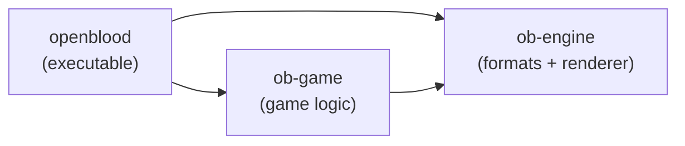
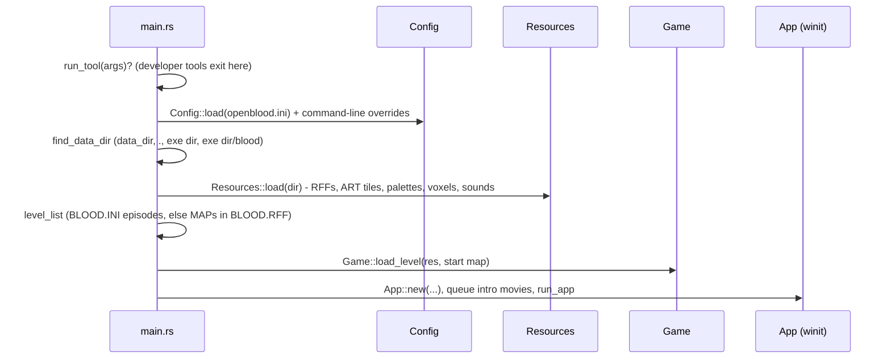
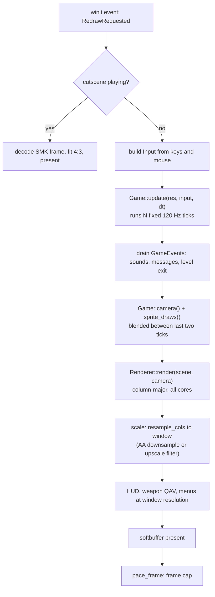
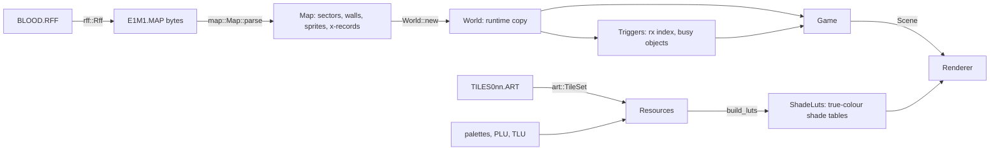

# Architecture

OpenBlood is a Cargo workspace of three crates with a strict one-way dependency chain:

| Crate | Knows about | Does not know about |
| --- | --- | --- |
| [`ob-engine`](Engine-Crate) | Build-engine data (sectors, walls, sprites, tiles), rendering, collision | Blood rules, windows, audio devices |
| [`ob-game`](Game-Crate) | Blood rules: player, weapons, enemies, triggers, items, saves | windows, input devices, audio output |
| [`openblood`](Frontend-Crate) | window, input, audio, HUD, menus, cutscenes, config, tools | — |

The game crate never touches the OS, so the whole simulation runs headless in tests and in
developer tools (`shotg`, `perf`, `noise-test`, ...).

## Coordinate conventions

Inherited from the Build engine (see `ob_engine::geom`):

- x grows east, y grows south, **z grows down**.
- One xy unit equals 16 z units.
- Angles: 2048 units per full turn, 0 = east, 512 = south.
- Shades: 0 = brightest, 63 = darkest (`palette::NUM_SHADES = 64`).

## Startup

`Resources` holds everything static and read-only (tiles, animations, palettes, lookup
tables, sounds). `Game` holds everything that changes and is serialized for saves.

## Frame loop

### Fixed tick, smooth frames

`Game::update` accumulates real time and runs whole ticks of 1/120 s
(`game::TICK_RATE`). Before each tick it snapshots every sprite's position and the player's
eye. When drawing, `camera()` and `sprite_draws()` blend between the snapshot and the current
state by the fraction of a tick already elapsed, so motion is smooth at any refresh rate while
the simulation stays deterministic. Large jumps (teleports, respawns) are not blended.

Mouse turn and look are applied only in the first tick of a frame, so turning speed does not
depend on frame rate.

### One tick

`Game::tick` runs, in order:

1. Level start: the first movement input broadcasts channel 7 (like the original).
2. Player movement and collision (`player.rs`, `ob_engine::collide`), room-over-room
   transitions, fall damage.
3. Use key, weapon switching, weapon state machine and firing, inventory and power-ups.
4. Sector enter/exit triggers.
5. Sprite animation sequences (SEQ) and their frame callbacks.
6. Enemy AI (`game/ai.rs`), projectiles, pickups and proximity triggers, damaging sectors.
7. Sector lighting effects (every second tick).
8. Trigger system update (busy motion of doors, lifts, sliding/rotating sectors), then carrying
   the player along with moving sectors.
9. Notices from triggers turned into game events (sounds, messages, secrets, level exits).

## Data flow of a level

## Saves

`game/save.rs` serializes the complete mutable `Game` with bincode. Static data is not saved;
it is reloaded from the original files. A test checks that continuing a game and reloading
its save produce identical states (determinism). The save format carries a version number
and older versions are rejected.

## Where to go next

- [Engine crate](Engine-Crate), [Game crate](Game-Crate), [Frontend crate](Frontend-Crate):
  module-by-module guides.
- [Renderer](Renderer): how a frame is drawn.
- [Triggers and Channels](Triggers-and-Channels): Blood's event system.
- [File Formats](File-Formats): the original data files.
