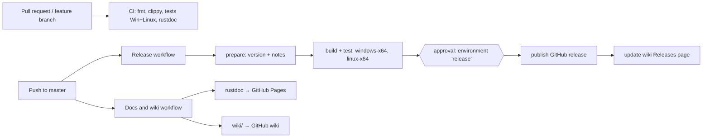

# CI and Releases

Three GitHub Actions workflows live in `.github/workflows/`.

## CI (`ci.yml`)

Runs on pull requests and pushes to branches other than `master`:

| Job | Command |
| --- | --- |
| rustfmt | `cargo fmt --all -- --check` (must pass) |
| clippy | `cargo clippy --workspace --all-targets` (warnings reported, not fatal yet) |
| test | `cargo test --workspace` and `cargo build --release` on Windows and Linux |
| rustdoc | `cargo doc --workspace --no-deps --document-private-items` with warnings as errors |

## Release (`release.yml`)

Runs on every push to `master` that changes code or build files (pushes that only touch
`wiki/`, Markdown, screenshots or the other workflows are skipped), and on demand from the
Actions tab.

1. **Version and notes.** The tag is `v<workspace version>.<run number>`, for example
   `v0.1.0.12`. Release notes list the commits since the previous `v*` tag.
2. **Build.** Windows and Linux runners run the unit tests, build in release mode and package
   `openblood-<tag>-windows-x64.zip` and `openblood-<tag>-linux-x64.tar.gz` (binary, README,
   license).
3. **Approval.** The publish job uses the `release` environment, which has **required
   reviewers**. The run pauses with *Waiting for review*; a reviewer opens the run, clicks
   **Review deployments**, ticks `release` and approves (or rejects). Nothing is published
   until then.
4. **Publish.** Creates the GitHub release and tag on the built commit, uploads both packages
   and `SHA256SUMS.txt`.
5. **Wiki.** Regenerates the [Releases](Releases) page from the GitHub releases API and pushes
   it to the wiki.

To start a new version series, bump `version` in `[workspace.package]` of `Cargo.toml`.

Rejecting or ignoring an approval leaves no tag or release behind; build artifacts expire
with the run.

## Docs and wiki (`docs.yml`)

Runs on pushes to `master` that touch `crates/`, `wiki/`, Cargo files or the workflow scripts:

- builds rustdoc for the whole workspace (private items included) and deploys it to GitHub
  Pages: <https://dagrigorev.github.io/OpenBlood/>;
- mirrors the `wiki/` folder into the GitHub wiki and regenerates the Releases page.

## Editing the wiki

The `wiki/` folder in the repository is the source of truth. Edit pages there, in a pull
request like code; after merge, the workflow publishes them. Pages edited directly on GitHub
are overwritten by the next sync. `Releases.md` is generated and must not be added to
`wiki/`.

Link pages by their file name without `.md`, e.g. `[Renderer](Renderer)`. Images are served
from the repository's `screenshots/` folder via `raw.githubusercontent.com`.

## One-time repository setup

Done once by a maintainer (already configured for this repository):

| Setting | Where |
| --- | --- |
| `release` environment with required reviewers, deployments limited to `master` | Settings → Environments |
| GitHub Pages source: **GitHub Actions** | Settings → Pages |
| Wiki enabled and initialised (the wiki git repository only exists after the first page is saved in the web UI) | Settings → General → Features, then the Wiki tab |

## Scripts

| Script | Purpose |
| --- | --- |
| `.github/scripts/sync-wiki.sh` | clones the wiki, replaces its pages with `wiki/`, writes the generated Releases page, commits and pushes when something changed |
| `.github/scripts/wiki-releases.sh` | prints the Releases page Markdown from the releases API (`gh` + `jq`) |

Both need `GITHUB_REPOSITORY` and a token with `contents: write` (`GITHUB_TOKEN` in the
workflows).
