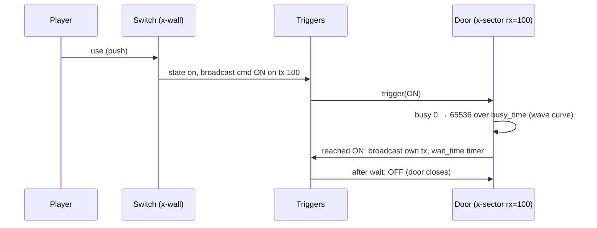

# Triggers and Channels

Blood levels are scripted entirely through map data: objects with an *extra* record
(x-sector, x-wall, x-sprite) talk to each other over numbered **channels**. OpenBlood's
implementation is `ob_game::triggers`.

## Model

Each x-object has:

| Field | Meaning |
| --- | --- |
| `rx_id` | channel it listens on |
| `tx_id` | channel it broadcasts on when it reaches its on or off state |
| `command` | what it sends on `tx_id` |
| `state` | current state, off (0) or on (1) |
| `busy_time` | seconds (tenths) to animate between states, e.g. a door opening |
| `wait_time` | seconds (tenths) before returning to the rest state |
| trigger flags | push, impact, touch, proximity, sight, enter/exit, pickup ... |
| `locked`, key | whether it reacts, which key it needs |
| `data1..data4` | type-specific values |

Flow:



Busy motion is a value from 0 to 65536 advanced each 120 Hz tick and shaped by Blood's
"wave" curves (`triggers::wave`). Times stored in tenths of a second are converted with
`tenths_to_ticks`.

## Commands (`triggers::cmd`)

| Value | Command |
| --- | --- |
| 0 / 1 | OFF / ON |
| 2 / 4 | STATE / NOT_STATE (follow or invert the sender's state) |
| 3 | TOGGLE |
| 5 | LINK |
| 6 / 7 / 8 | LOCK / UNLOCK / TOGGLE_LOCK |
| 9 / 10 / 11 | STOP_OFF / STOP_ON / STOP_NEXT |
| 12 | COUNTER_SECTOR |
| 20 / 21 | CALLBACK / REPEAT |
| 30 – 36 | sprite events: push, impact, pickup, touch, sight, proximity, explode |
| 40 – 43 | sector events: push, impact, enter, exit |
| 50 – 52 | wall events: push, impact, touch |

## Reserved channels (`triggers::chan`)

| Channel | Meaning |
| --- | --- |
| 1 | set total secrets |
| 2 | secret found |
| 3 | text over (message) |
| 4 | normal level exit |
| 5 | secret level exit |
| 7 | level start (single player) |
| 8 / 9 | level start (bloodbath / co-op) |
| 100+ | free for level designers |

Like the original, channel 7 is broadcast only after the player's **first movement input**,
not at load time. Turning or firing alone does not start the level.

## Sector types (`triggers::sector_type`)

| Type | Behaviour |
| --- | --- |
| 600 | z-motion: floor/ceiling move between off and on heights |
| 602 | z-motion that also moves marked sprites |
| 603 / 604 | warp / teleport |
| 612 | path sector (not used by any shipped map) |
| 613 | rotate step |
| 614 / 616 | slide (marked walls only / whole sector) |
| 615 / 617 | rotate (marked / whole) |
| 618 | damage |
| 619 | counter |

Sliding and rotating sectors carry the sprites standing in them, and `Game::carry_player`
moves the player with them, so boats, trains and moving platforms work. Walls shared between
sectors are moved together through vertex groups.

### Frozen slides

Some slide sectors would fold a neighbouring sector over itself if fully moved (E1M1's
coffin, E2M6, BB1). The original never shows that, so `Triggers::frozen_slides` keeps those
sectors still. Split doors are excluded from the check.

## Debugging a level's scripting

```
openblood chan <DATA> E1M1 100     # every object listening or sending on channel 100
openblood frozen-slides <DATA>     # slide sectors kept still
```

See [Developer Tools](Developer-Tools).
